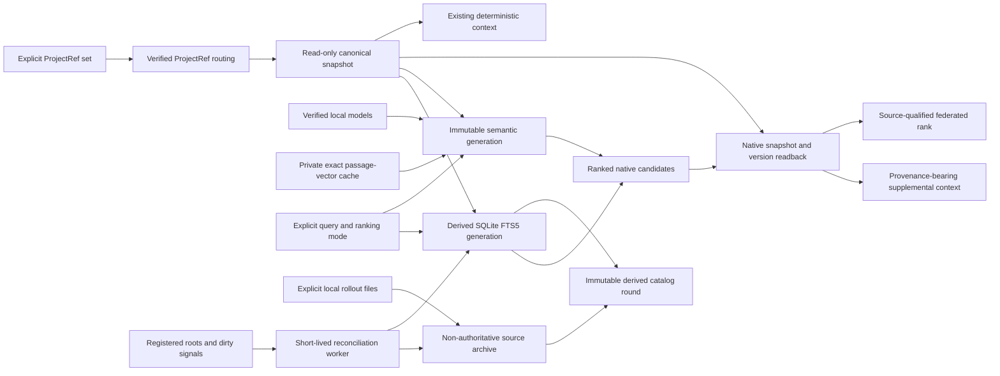

# Local Derived Search

ADR-0525 accepts the first-stage local lexical retrieval boundary. Record and
Knowledge statements may be searched through a separate FTS5 index, while
canonical source identity, version and currentness remain native read concerns.
The initial capability is opt-in and does not change `context`, `recall`, exact
Record list filters, Task readiness or mutation authorization.
ADR-0526 extends the explicit search surface with on-demand local generation
preparation; the canonical and full-output contracts remain the same.
ADR-0527 adds explicit native local vector, full-corpus reranking and fusion
modes. ADR-0528 adds non-authoritative source archives, explicit multi-ProjectRef
read federation and content-addressed incremental passage-vector reuse. None of
these surfaces changes canonical Work-State or becomes an implicit default.
ADR-0529 adds an optional, disabled-by-default single-user reconciliation
runtime whose watcher only marks sources dirty. ADR-0530 adds explicitly
registered automatic history import and immutable, lane-separated global
derived catalog rounds. Neither decision creates a global canonical
KnowledgeSpace or an automatic semantic write path.

## Authority and Data Flow

The CLI resolves the existing project binding using the normal control-plane
read gate. The core adapter receives explicit ProjectRef, Store, Workspace,
Branch and snapshot anchors; its caller owns ProjectRef proof, and core checks
the actual Store and branch/workspace identity. The binding ProjectRef is not a
reconstruction of the semantic origin of every legacy statement. Original scope
and provenance must remain distinguishable from the read anchor.

Source opening retains complete integrity validation. Export and readback share
one immutable source snapshot and request-scoped replay cache. Current reads
capture the selected branch head and reject head drift rather than mixing two
snapshots. Explicit historical reads use a commit in the same workspace that is
reachable through the full parent DAG of the selected branch, including a
merged secondary parent; their temporal label remains historical regardless
of an object's active status at that commit. Current queries verify the captured
head/digest again before returning. This final check is the freshness boundary;
later native changes can invalidate the next use of that generation.

## Derived Generation

An index is a rebuildable local file, not a WorkVCS Store or canonical
projection used to drive mutation. Its manifest binds format/tokenizer/snippet
versions, the source read identity, source commit/state digest, temporal scope
and object-version basis. Candidate rows carry exact statement and version
identity, status, digest and UTF-8 byte ranges.

Only delivered canonical membership is exported. An operation journal entry or
pending Capture is not an indexed current fact. Refresh builds and validates an
exclusively created temporary file and atomically publishes a complete
generation at a new destination with kernel no-replace semantics. Same-basis
healthy refresh is idempotent. Every other existing generation is preserved;
refresh requires a new destination rather than replacing a pathname that an
external writer could have changed. Cooperative publishers use a directory
lock and a final source guard. Old generations retain their explicit anchors;
they do not become current after a branch head advance.

Managed queries prepare or reuse generations in a local derived directory.
Selection hashes the complete source identity, current/historical scope,
commit/state and object-version basis, plus all applicable search and model
policy versions. A name only narrows the candidate set; full validation
establishes whether a generation can be reused. Damaged or unknown entries are
preserved and a unique new generation is published. There is no mutable
current-generation pointer, automatic deletion, watcher or source-write hook.
Prepare and query share one native snapshot rather than repeating canonical
replay. Lexical generations are rebuilt as complete immutable files. Semantic
generations are also rebuilt as complete immutable directories, while exact
unchanged passage vectors may be reused from the separate ADR-0528 cache.
Healthy queries do not hold the publisher lock. On a miss, publication takes
the directory lock and checks for a matching healthy generation again using
the same source snapshot. After publication and complete index readback, a
managed query's final freshness guard reports head drift with no items and
retains the generation path and actual derived-write outcome.

Destination validation rejects source Store paths, control-plane files, path
aliases, reserved source SQLite sidecar names and unrelated existing files.
Derived-file version mismatch requires an explicit rebuild at a new acceptable
destination, not a canonical migration or an overwrite. Platforms lacking the
required atomic-file guards reject publication. Refresh has no reason to write a WorkStateCommit,
Event, branch ref, registry binding, marker, or new semantic object.

## Semantic Generation and Incremental Vector Reuse

A semantic generation binds the verified local embedding model, complete
passage catalogue, source snapshot and runtime policy. Qdrant Edge is embedded
in the process and private to the generation. Exact search requests the
manifest's complete point count, quantization is disabled, and every returned
point must correspond to one catalogue range before object aggregation. Modes
that use BGE score the complete query-window and passage-window pair set; fusion
uses complete one-based component ranks. Caller top-k is a final projection.

Provisioned model manifests cover graph, external data, tokenizer and config
bytes. Ordinary query uses only verified local user-defined model loaders and
does not have a download fallback. Model context length creates deterministic
overlapping windows; it is not a Token or work budget. Every window is
processed.

The optional embedding cache is outside every immutable generation. A cache key
binds the model-manifest digest and complete prefixed passage input. Its binary
record repeats the key and model, fixes the dimension and protects the complete
vector bytes with a digest. Private permissions, no symbolic links and
no-replace publication are mandatory. Concurrent publication accepts one
complete winner.

Cache misses are embedded in full. One invalid selected entry invalidates all
hits in that build attempt and triggers a recorded complete recomputation, so a
generation never contains a mixture that depends on untrusted partial cache
state. Explicit full rebuild bypasses both reads and writes. The manifest's hit,
computed, write and failure counts must reconcile with its complete point
count.

Cache reuse does not make a prior generation current. Every different source
basis receives a new catalogue, shard and final native freshness guard. The
cache only avoids repeating exact model work for byte-identical passage input.
There is no resident model process or background builder in this delivery.

## Optional Local Automation Runtime

The post-V1 runtime is one per-user coordinator, disabled unless the user
starts it explicitly. In legacy mode, registration preview is read-only and
apply uses the exact automation-registry revision and digest. In the current
global-policy mode, a selected registry-v2 read yields the complete valid
ProjectRef member snapshot while a separate owner-private source policy grants
exact rollout-root permission. The two bases are captured independently in
every round; neither can bootstrap a ProjectRef or infer arbitrary filesystem
permission. Its owner-private, versioned Unix socket accepts bounded local
control messages only from the same user.
The daemon owns no canonical Store, model or index handle. Startup, manual,
watcher-overflow and periodic reconciliation spawn short-lived workers that use
the same foreground operation and publication contracts.

Watcher events are hints. A capacity-one signal coalesces them into a dirty
state instead of an unbounded queue; observed events, coalesced signals,
backend errors and the last bounded error remain separately inspectable.
Watcher setup and backend errors also mark the system dirty and rely on the
same full reconciliation rather than suppressing the coordinator. Thus
delete, rename, replacement, permission change, overflow and lost-event
conditions all converge through a complete registered-root scan. A worker
re-resolves and checks ProjectRef, Store, Workspace, Branch and registry basis
before each round. A canonical routing or Store failure does not skip the
independent historical lane. Each successfully scanned rollout root owns its
own deletion decision; a failed root or file observation retains and
revalidates its prior immutable archive while recording a separate failure.
Drift is quarantined rather than repaired. The runtime never
modifies Store state, the ProjectRef registry, Exposure/source-status, source
files, archives or existing generations and performs no automatic cleanup.

Worker stdout and stderr are drained under fixed bounds. The latest bounded raw
streams, byte counts, full-stream digests, truncation state and timeout/exit
state are atomically projected into an owner-private runtime evidence record.
Only a parsed reconciliation report whose catalog identity and completeness
match native current-basis readback becomes `completed` or `partial_failure`;
nonzero exit, timeout, malformed output, unexpected stderr or output overflow
remains failed.

## Explicit Historical Source Archives

A source archive is a separate private derived directory created only from
caller-selected local Codex rollout files. It contains extracted user and
optionally assistant message text plus exact thread, message, role, line, path
and byte-digest provenance. Developer, system, tool and non-text content is
excluded and counted.

Every archive result is fixed as historical reference with unknown currentness
and no action authority. The archive does not create canonical Records or
Knowledge, and archive rank never changes lifecycle, ownership or permission.
Same bytes and identity reuse the same basis; changed bytes select another
archive. Query reports whether the original source is still present and
unchanged without making source availability a condition for immutable archive
readback.

## Explicit Multi-Project Read Federation

Federation requires at least two unique ProjectRefs. Each is discovered and
opened independently, and its opened StoreId must match its active read
binding. Every source runs a complete lexical or semantic query before the
federated layer combines source-local ranks with the versioned source RRF
policy. Final output limits are applied only after that complete combination.

Each hit and source report retains ProjectRef, Store, Workspace, Branch,
commit, state and temporal scope. Identical entity IDs from different sources
remain distinct. A source error is included as a partial failure, never omitted
as if the request were complete. Federation is a request-scoped read and has no
cross-Store mutation, replication or shared-state semantics.

## Global Derived Search Catalog

An immutable catalog round fixes one automation-registration revision and an
ordered ProjectRef/source set. `canonical_current` contains only generations
that pass native final-currentness validation. `historical_reference` contains
source archives and explicit historical generations with no action authority.
The manifest holds verified references and source reports rather than copying
canonical objects into a new authority.

Catalog query validates every referenced artifact, preserves complete source
identity and applies the same complete-local-ranking-before-final-projection
rule as explicit federation. Failed or stale sources remain in the response;
partial results have `complete=false`. A catalog is not a KnowledgeSpace,
replica, canonical projection, shared mutable index, or cross-Store write
surface.

Manifest readback recomputes `complete` from every source status and rejects a
contradictory claim. Reconciliation reuses the newest current-basis catalog
only when its ordered sources and completeness are identical; otherwise it
publishes a new immutable round with a monotonic basis-local timestamp. This
prevents no-change growth without a mutable current pointer or stale-latest
selection when source health changes and later returns.

## Candidate Readback and Output

FTS5 ranks lexical candidates without a default cost-based prefetch ceiling.
The whole generation must match native-derived documents, exact window/term
membership and FTS5 posting integrity before a successful search. Native
readback then verifies each
candidate's snapshot membership, entity/version identity, object digest,
statement and actual snippet bytes. Current mode uses native eligible Record
statuses (active/running/unverified/validated) and active Knowledge; superseded
and invalidated cognition cannot be
ranked back into current state. The existing context resolver alone owns any
causal-summary exception. Search does not project or infer Task runnable state.

Semantic candidates pass the same native object, status, statement, range and
freshness readback after complete vector, reranker or fusion ranking. A valid
model score cannot compensate for a failed native check. Federation preserves
that proof per source. Source-archive results instead carry their immutable
rollout provenance and fixed non-authoritative labels; they are never presented
as native canonical readback.

Automatic reconciliation scans each policy-approved shared rollout root once,
verifies session metadata against the selected registry member snapshot before
importing a body, and remembers the last successful archive reference per
attributed source. It revalidates that immutable artifact for unchanged input
and keeps it in the historical-reference lane after source deletion or a failed
replacement import. Conflicting, unbound, excluded or drifted attribution is a
quarantine observation, not a fallback to another ProjectRef. The same catalog
round also carries explicit failed or quarantined source observations, so
preserved historical retrieval and current source health remain separate and
the aggregate result stays incomplete.

The result exposes source/temporal scope, original status and provenance, native
readback result, complete canonical statement and all matching source ranges.
A related or recently written
statement may still require fresh observation to answer a present-tense
question. Successful readback proves stored source correspondence, not the
truth of its business claim or permission for a new action.

By the user's amended authority, retrieval has no default token budget or
cost-based result/range ceiling. Complete items retain original provenance and
statement text. Exact compact item JSON is counted with fixed o200k_base
ordinary encoding for observation; no item is dropped to fit that counter.
An explicitly requested top-k is a caller's query projection. The existing
mandatory ContextPacket and its own budget contract are unchanged. Full CLI
diagnostics and model billing are separate measurements.

## Failure and Recovery

Source identity/integrity/routing failures remain source errors. A derived
failure does not authorize bypassing these checks. Missing, stale, incompatible
or damaged explicit-index state reports its reason and a native-read or refresh
next step. Managed queries may create a new derived generation on demand,
reporting its maintenance outcome separately from canonical writes.
No stale current candidates or unexplained empty-success response
may conceal an unavailable index.

Changing tokenizer, snippet rules or source membership establishes a new
generation basis. Frozen real queries and independent labels evaluate each
such change. A private fixture may hold copied historical text for a benchmark,
but that fixture and its resulting Record identities cannot be promoted into
live project authority.

## Scope and Validation

The accepted scope is explicit local lexical and semantic Record/Knowledge
retrieval with native readback, explicit and registered automatic
non-authoritative history archives, explicit federation, immutable global
derived catalogs and foreground-compatible incremental work. Current exact
reads, deterministic context resolution, lifecycle, runnable state and
authorization retain their existing contracts.

This scope includes only explicitly policy-authorized automatic transcript
discovery into the historical-reference lane and the disabled-by-default local
runtime defined by ADR-0529/0530 as amended by ADR-0531. It still excludes
canonical transcript extraction,
semantic merge, a global canonical Knowledge Space, replication, cross-Store
mutation, automatic Agent execution, service auto-installation and automatic
cleanup.

Implementation validation separately proves normal and historical retrieval,
state and ancestry filtering, identity/version/range rejection, source byte
stability, safe publication, controlled concurrent head advance, truthful
derived and partial failure, complete source and candidate coverage, model
offline behavior, cache damage and full-rebuild recovery, and final native
freshness without default cost limits. Measured latency, token counts, binary
size and resident memory are local evidence; they do not redefine coverage.
Installation and adoption remain a separate delivery boundary.
