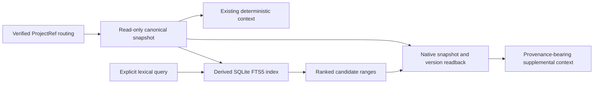

# Local Derived Search

ADR-0525 accepts the first-stage local lexical retrieval boundary. Record and
Knowledge statements may be searched through a separate FTS5 index, while
canonical source identity, version and currentness remain native read concerns.
The initial capability is opt-in and does not change `context`, `recall`, exact
Record list filters, Task readiness or mutation authorization.
ADR-0526 extends the explicit search surface with on-demand local generation
preparation; the canonical and full-output contracts remain the same.

## Authority and Data Flow

The CLI resolves the existing project binding using the normal control-plane
read gate. The core adapter receives explicit ProjectRef, Store, Workspace,
Branch and snapshot anchors; its caller owns ProjectRef proof, and core checks
the actual Store and branch/workspace identity. The binding ProjectRef is not a
reconstruction of the semantic origin of every legacy statement. Original scope
and provenance must remain distinguishable from the read anchor.

Source opening retains complete integrity validation. Export and readback share
one immutable source snapshot and request-scoped replay cache. Current reads
capture the selected branch head and reject head drift rather than mixing two
snapshots. Explicit historical reads use a commit in the same workspace that is
reachable through the full parent DAG of the selected branch, including a
merged secondary parent; their temporal label remains historical regardless
of an object's active status at that commit. Current queries verify the captured
head/digest again before returning. This final check is the freshness boundary;
later native changes can invalidate the next use of that generation.

## Derived Generation

An index is a rebuildable local file, not a WorkVCS Store or canonical
projection used to drive mutation. Its manifest binds format/tokenizer/snippet
versions, the source read identity, source commit/state digest, temporal scope
and object-version basis. Candidate rows carry exact statement and version
identity, status, digest and UTF-8 byte ranges.

Only delivered canonical membership is exported. An operation journal entry or
pending Capture is not an indexed current fact. Refresh builds and validates an
exclusively created temporary file and atomically publishes a complete
generation at a new destination with kernel no-replace semantics. Same-basis
healthy refresh is idempotent. Every other existing generation is preserved;
refresh requires a new destination rather than replacing a pathname that an
external writer could have changed. Cooperative publishers use a directory
lock and a final source guard. Old generations retain their explicit anchors;
they do not become current after a branch head advance.

Managed queries prepare or reuse generations in a local derived directory.
Selection hashes the complete source identity, current/historical scope,
commit/state and object-version basis, plus all search policy versions. A name
only narrows the candidate set; full validation establishes whether a generation
can be reused. Damaged or unknown entries are preserved and a unique new
generation is published. There is no mutable current-generation pointer,
automatic deletion, watcher or source-write hook. Prepare and query share one
native snapshot rather than repeating canonical replay. This implementation
rebuilds a changed generation; it does not claim incremental object updates.
Healthy queries do not hold the publisher lock. On a miss, publication takes
the directory lock and checks for a matching healthy generation again using
the same source snapshot. After publication and complete index readback, a
managed query's final freshness guard reports head drift with no items and
retains the generation path and actual derived-write outcome.

Destination validation rejects source Store paths, control-plane files, path
aliases, reserved source SQLite sidecar names and unrelated existing files.
Derived-file version mismatch requires an explicit rebuild at a new acceptable
destination, not a canonical migration or an overwrite. Platforms lacking the
required atomic-file guards reject publication. Refresh has no reason to write a WorkStateCommit,
Event, branch ref, registry binding, marker, or new semantic object.

## Candidate Readback and Output

FTS5 ranks lexical candidates without a default cost-based prefetch ceiling.
The whole generation must match native-derived documents, exact window/term
membership and FTS5 posting integrity before a successful search. Native
readback then verifies each
candidate's snapshot membership, entity/version identity, object digest,
statement and actual snippet bytes. Current mode uses native eligible Record
statuses (active/running/unverified/validated) and active Knowledge; superseded
and invalidated cognition cannot be
ranked back into current state. The existing context resolver alone owns any
causal-summary exception. Search does not project or infer Task runnable state.

The result exposes source/temporal scope, original status and provenance, native
readback result, complete canonical statement and all matching source ranges.
A related or recently written
statement may still require fresh observation to answer a present-tense
question. Successful readback proves stored source correspondence, not the
truth of its business claim or permission for a new action.

By the user's amended authority, retrieval has no default token budget or
cost-based result/range ceiling. Complete items retain original provenance and
statement text. Exact compact item JSON is counted with fixed o200k_base
ordinary encoding for observation; no item is dropped to fit that counter.
An explicitly requested top-k is a caller's query projection. The existing
mandatory ContextPacket and its own budget contract are unchanged. Full CLI
diagnostics and model billing are separate measurements.

## Failure and Recovery

Source identity/integrity/routing failures remain source errors. A derived
failure does not authorize bypassing these checks. Missing, stale, incompatible
or damaged explicit-index state reports its reason and a native-read or refresh
next step. Managed queries may create a new derived generation on demand,
reporting its maintenance outcome separately from canonical writes.
No stale current candidates or unexplained empty-success response
may conceal an unavailable index.

Changing tokenizer, snippet rules or source membership establishes a new
generation basis. Frozen real queries and independent labels evaluate each
such change. A private fixture may hold copied historical text for a benchmark,
but that fixture and its resulting Record identities cannot be promoted into
live project authority.

## Scope and Validation

The accepted scope is Record/Knowledge lexical candidates with native readback,
not transcript extraction, vector retrieval, semantic merge, project
federation, automatic execution or a background service. Current V1 exact reads
and context resolution retain their existing contracts.

Implementation validation must separately prove normal retrieval, state and
ancestry filtering, identity/version/range rejection, source byte stability,
safe refresh and aliases, controlled concurrent head advance, truthful derived
failure and complete source delivery without default cost limits. The candidate's measured
cold/warm latency, token counts, binary size and resident memory are local
evidence; installation and adoption remain a later delivery boundary.
